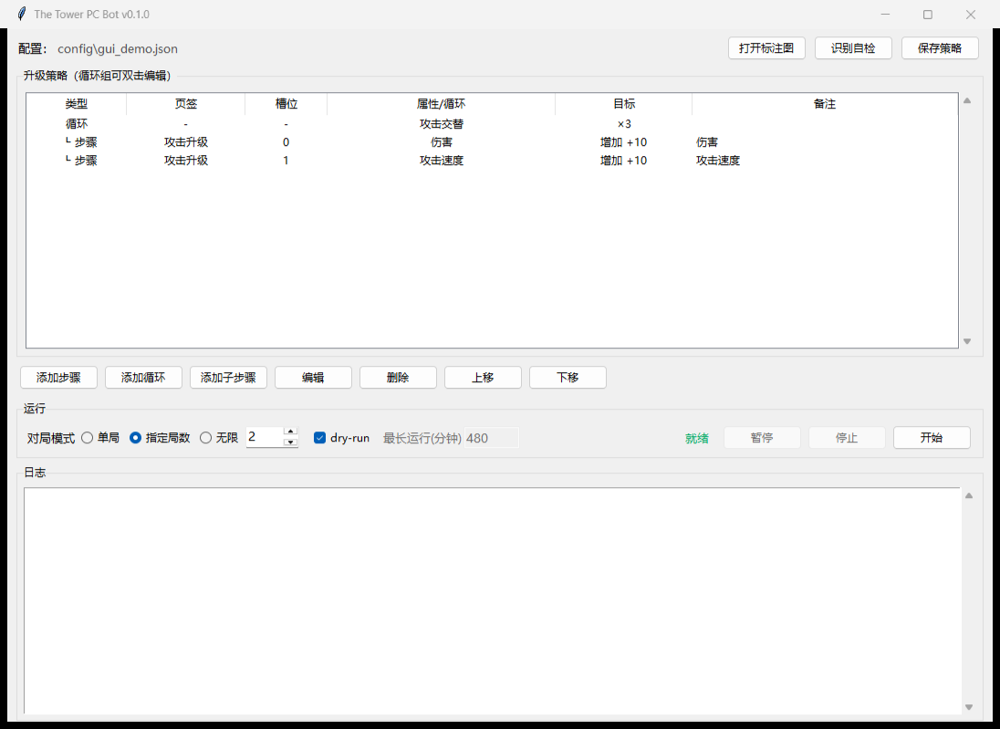

# The Tower PC Bot

Windows 上通过 BlueStacks 5 + ADB 运行的《The Tower - Idle Tower Defense》自动升级工具。不占用真实鼠标，BlueStacks 最小化时也能操作。



## 能做什么

- 按策略自动购买攻击、防御、功能页属性；
- 支持绝对等级和相对等级（每轮 +N）；
- 支持一层循环，例如“伤害 +10、攻击速度 +10，循环 3 次”；
- 支持单局、指定局数和无限对局；
- 游戏结束自动处理：单局回主页，多局/无限点重试；
- 识别价格、等级和满级状态，失败时停止并保存截图；
- 提供图形界面，可编辑策略、dry-run、暂停和停止。

## 直接使用 EXE

1. 打开 BlueStacks 5 的 ADB 访问；
2. 把游戏设置为竖屏，截图尺寸应为 `1080×2400`；
3. 从 [GitHub Releases](https://github.com/Fandyv1/The-tower-bot/releases) 下载 `TheTowerBot.exe`；
4. 把 exe 放到一个可写目录，双击运行；
5. 首次运行会在 exe 旁生成 `config/` 和 `logs/`。

### 基本操作

1. 点击「添加步骤」，选择页签、属性、绝对/相对等级和目标；
2. 需要循环时点击「添加循环」，再添加子步骤；
3. 先勾选 `dry-run` 点「开始」，确认识别正常；
4. 取消 `dry-run`，选择单局/指定局数/无限，点「开始」；
5. 运行中可「暂停」「继续」「停止」。

## 环境要求

- Windows 10/11；
- BlueStacks 5；
- 游戏版本 `29.1.2` 或更新；
- BlueStacks 开启 ADB（设置 → 高级 → Android Debug Bridge）；
- 如果使用源码运行，需要 Python 3.12。

## 从源码运行

```powershell
pip install -r requirements.txt
Copy-Item config\tower.example.json config\tower.json
python -m towerbot_pc.cli doctor
run_gui.bat
```

命令行示例：

```powershell
python -m towerbot_pc.cli run --dry-run
python -m towerbot_pc.cli run --max-runtime 60
python -m towerbot_pc.cli run --runs 3
python -m towerbot_pc.cli run --infinite
```

## 日志与故障

- 日志：`logs/engine.log`
- 失败截图：`logs/fail_*.png`
- 识别自检：GUI 里的「识别自检」，或 `python -m towerbot_pc.cli doctor`

遇到问题先看日志和失败截图。已知限制：滚动依赖 OCR、极端低画质可能读不到属性名；自动化可能违反游戏服务条款。

## 打包

```powershell
python -m PyInstaller packaging\TheTowerBot.spec --noconfirm --clean
```

生成的 `dist/TheTowerBot.exe` 为单文件 GUI 程序。构建需要 PyInstaller；配置文件默认生成在 exe 同目录。

## License

GPL-3.0，见 [LICENSE](LICENSE)。
